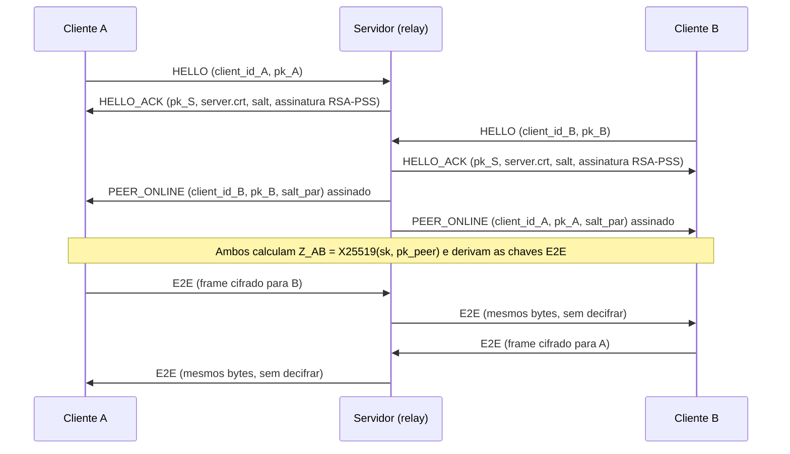

# Mensageria Segura Multi-Cliente

Sistema de mensagens multi-cliente com **criptografia ponta a ponta (E2E)** escrito em Java puro. O servidor funciona apenas como *relay*: autentica-se aos clientes, distribui as chaves públicas e encaminha os frames, mas não tem como decifrar o conteúdo das mensagens.

Trabalho Prático 3 da disciplina de Segurança da Informação, na UFC.

## Funcionalidades

- **Confidencialidade e integridade:** AES-128-GCM (AEAD) com tag de 16 bytes.
- **Autenticidade do servidor:** certificado RSA autoassinado pinado no cliente e assinaturas RSA-PSS (SHA-256).
- **Sigilo perfeito (forward secrecy):** chaves X25519 efêmeras (ECDHE) geradas a cada conexão.
- **Derivação de chaves:** HKDF-SHA256 com chaves independentes por direção (`A2B` / `B2A`).
- **Proteção contra replay:** `seq_no` monotônico por direção, validado pelo destinatário.
- **Framing robusto:** prefixo de tamanho de 4 bytes big-endian. Frames inválidos encerram a conexão.
- **Sem dependências externas:** usa apenas a API criptográfica padrão do JDK.

## Arquitetura



### Handshake

1. O cliente gera um `client_id` (UUID v4) e um par X25519 efêmero, e envia `client_id (16B) || pk_cliente (32B, raw)`.
2. O servidor responde com sua chave pública X25519 efêmera (`pk_S`), o certificado `server.crt`, um `salt` de 16 bytes e a assinatura RSA-PSS sobre
   `H = SHA256(pk_S || pk_cliente || client_id || salt)`.
3. O cliente compara o certificado recebido com o `server.crt` pinado localmente e verifica a assinatura. Se qualquer verificação falhar, a conexão é abortada.

### Distribuição de chaves

Sempre que um cliente se conecta, o servidor envia a ele as chaves públicas dos clientes já conectados e envia a chave do novo cliente a todos os outros, em mensagens `PEER_ONLINE`.

Cada par de clientes recebe um **salt de 16 bytes exclusivo**, igual nas duas pontas. Isso permite que ambos derivem as mesmas chaves, já que o salt de handshake é individual de cada cliente.

As mensagens administrativas (`PEER_ONLINE` e `PEER_OFFLINE`) são assinadas com RSA-PSS e incluem o destinatário, um contador (`seq_send`) e o salt do handshake, o que impede adulteração, redirecionamento e replay.

### Derivação das chaves E2E

```text
Z_AB    = X25519(sk_A, pk_B)
PRK     = HKDF-Extract(salt_par, Z_AB)
Key_A2B = HKDF-Expand(PRK, "A2B", 16)
Key_B2A = HKDF-Expand(PRK, "B2A", 16)
```

O papel `A` cabe ao cliente de menor UUID. O segredo `Z_AB` nunca é transmitido e é apagado da memória logo após a derivação.

### Formato do frame E2E

```text
[tipo (1B)] [nonce (12B)] [sender_id (16B)] [recipient_id (16B)] [seq_no (8B)] [ciphertext + tag (16B)]
```

| Campo | Definição |
|---|---|
| `nonce` | `IV_base (4B, aleatório por direção) \|\| seq_no (8B, big-endian)` |
| `AAD` | `sender_id \|\| recipient_id \|\| seq_no` |
| `seq_no` | contador monotônico por direção, iniciando em 0 |

O destinatário valida os identificadores, a consistência entre o nonce e o `seq_no`, o IV base da sessão, o anti-replay e a tag GCM. O contador de recebimento só é atualizado depois que a tag é validada.

### Tipos de frame

| Tipo | Valor | Direção | Conteúdo |
|---|---|---|---|
| `HELLO` | 1 | cliente → servidor | `client_id`, `pk_cliente` |
| `HELLO_ACK` | 2 | servidor → cliente | `pk_S`, certificado, `salt`, assinatura |
| `PEER_ONLINE` | 3 | servidor → cliente | `seq`, `peer_id`, `pk_peer`, `salt_par`, assinatura |
| `E2E` | 4 | cliente ↔ cliente (via relay) | mensagem cifrada |
| `PEER_OFFLINE` | 5 | servidor → cliente | `seq`, `peer_id`, assinatura |

Cada frame é precedido por 4 bytes big-endian com seu tamanho.

## Estruturas de dados

**Servidor**: uma sessão por `client_id`:

| Campo | Descrição |
|---|---|
| `saida` | stream de escrita do socket do cliente |
| `pk` | chave pública X25519 do cliente (32B) |
| `seqRecv` | último `seq_no` recebido do cliente (inicia em -1) |
| `seqAdmin` | próximo `seq_no` das mensagens administrativas (inicia em 0) |
| `saltHandshake` | salt de 16B gerado no handshake |

**Cliente**: um objeto `Par` por cliente remoto:

| Campo | Descrição |
|---|---|
| `publicaPeer` | chave pública X25519 do peer |
| `enviarChave` / `receberChave` | chaves AES-128 derivadas via HKDF |
| `proximoSeq` / `ultimoRecebido` | contadores de envio e de recebimento (anti-replay) |
| `ivEnviar` / `ivReceber` | IV base de cada direção |

## Requisitos

- JDK 21 ou superior (`java`, `javac` e `keytool` no PATH)

## Instalação

Gere o par de chaves RSA do servidor (`server.p12`) e o certificado (`server.crt`) e compile o projeto:

**Windows (PowerShell)**

```powershell
$env:RELAY_KEYSTORE_PASSWORD = 'sua-senha'
.\scripts\setup.bat
.\scripts\compilar.bat
```

**Linux / macOS**

```bash
export RELAY_KEYSTORE_PASSWORD='sua-senha'
bash scripts/setup.sh
bash scripts/compilar.sh
```

O `setup` só precisa ser executado uma vez e não sobrescreve chaves existentes. As classes compiladas ficam em `out/`.

## Uso

**Servidor** (a variável `RELAY_KEYSTORE_PASSWORD` precisa estar definida):

```bash
java -cp out Servidor [porta] [keystore]
```

Os padrões são a porta `5555` e o keystore `server.p12`.

**Cliente:**

```bash
java -cp out Cliente [host] [porta] [certificado] [client_id]
```

Os padrões são `localhost`, `5555` e `server.crt`. Se `client_id` for omitido, um UUID v4 novo é gerado. Informar um UUID anterior permite reconectar com a mesma identidade, sempre com chaves e salts novos.

Para conectar a partir de outra máquina, o `server.crt` deve ser copiado por um canal confiável. O certificado recebido pela rede nunca é aceito sem o arquivo pinado.

> No Windows, execute `chcp 65001` no terminal (ou use `java -Dstdout.encoding=UTF-8 ...`) para exibir corretamente os caracteres acentuados.

### Comandos do cliente

| Comando | Descrição |
|---|---|
| `lista` | Lista os clientes conectados |
| `enviar <UUID> <texto>` | Envia uma mensagem cifrada ao cliente indicado |
| `teste-bitflip <UUID> <texto>` | Envia um frame com a tag GCM adulterada, que o destinatário rejeita |
| `teste-replay <UUID> <texto>` | Envia o mesmo frame duas vezes: o destinatário aceita o primeiro e rejeita o segundo |
| `teste-framing` | Envia um prefixo de tamanho inválido, e o servidor encerra a conexão |
| `sair` | Encerra o cliente |

### Exemplo

```text
$ java -cp out Cliente
Conexão autenticada com o servidor. Seu client_id: 1d2c...-...
Novo cliente: 7f3a...-...
enviar 7f3a...-... olá!
Mensagem E2E enviada (79 bytes cifrados no frame).
```

O servidor registra apenas o evento de relay, com o remetente, o destinatário e o tamanho do frame:

```text
Relay 1d2c...-... -> 7f3a...-...: 79 B
```

## Testes

```bash
java -cp out TestesSeguranca
```

| Teste | Verifica |
|---|---|
| Chaves X25519 raw | chaves públicas com 32 bytes |
| ECDH | segredo idêntico nas duas pontas |
| AES-GCM ida e volta | o destinatário decifra nos dois sentidos |
| Anti-replay | frame repetido rejeitado |
| Bitflip | tag adulterada rejeitada |
| Contador após bitflip | rejeição não altera o estado de recebimento |
| Framing inválido | tamanho acima do limite rejeitado |
| Framing truncado | frame incompleto rejeitado |
| RSA-PSS | assinatura válida aceita e material alterado rejeitado |

## Estrutura do projeto

```text
src/
├── Servidor.java          # relay: handshake, sessões, distribuição de chaves e encaminhamento
├── Cliente.java           # CLI: validação do servidor, envio e recebimento
├── Par.java               # estado E2E por peer: chaves, contadores e IVs
├── Criptografia.java      # X25519, HKDF-SHA256, RSA-PSS e AES-128-GCM
├── Protocolo.java         # framing TCP, tipos de frame e limites
└── TestesSeguranca.java   # testes automatizados
scripts/
├── setup.sh / setup.bat         # geração do keystore e do certificado
└── compilar.sh / compilar.bat   # compilação
```

## Parâmetros e limites

| Parâmetro | Valor |
|---|---|
| Curva ECDHE | X25519 (chaves raw de 32 bytes) |
| Chave RSA do servidor | 3072 bits, certificado válido por 365 dias |
| Salt | 16 bytes |
| Nonce | 12 bytes |
| Texto claro por mensagem | até 4096 bytes (UTF-8) |
| Tamanho máximo de frame | 16384 bytes |
| Clientes simultâneos | 100 (conexões excedentes ou com `client_id` duplicado são recusadas) |
| Timeout do handshake | 10 segundos |

## Segurança

- **Chaves privadas:** a chave privada X25519 do cliente nunca sai do processo. O `server.p12` contém a chave RSA do servidor e não deve ser versionado nem distribuído.
- **Logs:** o servidor registra apenas conexões, desconexões, `client_id`, tamanhos de frame e motivos de rejeição. Chaves, segredos, salts, nonces e conteúdo de mensagens nunca são registrados.
- **Reconexão:** ao desconectar, a sessão é removida e os demais clientes são notificados. Uma nova conexão sempre executa o handshake completo com chaves, salts e contadores novos.

### Limitações

- Apenas o servidor é autenticado. Os clientes confiam nas chaves públicas distribuídas pelo servidor autenticado.
- Não há persistência de mensagens, histórico nem rotação periódica de chaves dentro de uma mesma sessão.
